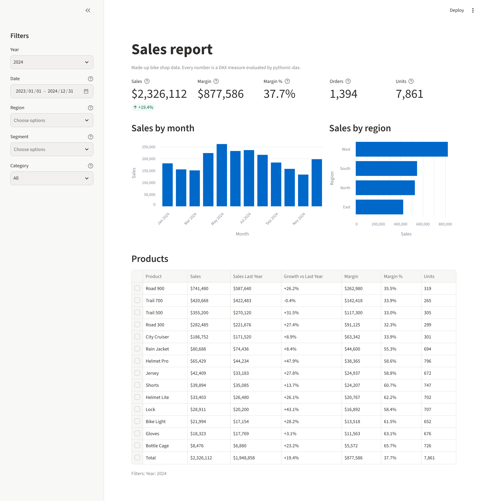

# Pythonic DAX

Python functions that behave exactly like DAX in Power BI, used as the calculation
engine behind Streamlit apps.

> **Guiding ethos:** the Python should operate as closely as possible to how DAX works
> in Power BI today.

```python
import pythonic_dax as pdax
from pythonic_dax import ALL, CALCULATE, DIVIDE, SUM, SUMMARIZECOLUMNS

model = pdax.Model()
Sales = model.add_table("Sales", sales_df)
Product = model.add_table("Product", product_df)
model.add_relationship(Sales["ProductKey"], Product["ProductKey"])

total = model.add_measure("Total Sales", SUM(Sales["Amount"]))
share = model.add_measure("Share", DIVIDE(total, CALCULATE(total, ALL(Product))))

model.evaluate(SUMMARIZECOLUMNS(Product["Color"], {"Total": total, "Share": share}))
```

## Status

**Phase 1 (data model) is done.** You can build a model the way Power BI's semantic model works:

```python
from pythonic_dax.sources import Database, Parquet

model = pdax.Model(description="Exam revenue")
Exams = model.add_table(
    "Exams",
    Parquet("data/exams/*.parquet"),
    description="One row per exam taken.",
    columns={"VOID_FL": {"description": "A flag for voids.", "display_name": "Voided?"}},
)
Date = model.add_table("Date", Database("SELECT * FROM dim_date", connection))
Date.mark_as_date_table("Date")

model.add_relationship(Exams["ExamDate"], Date["Date"])
model.add_relationship(Exams["BilledDate"], Date["Date"], active=False)  # for USERELATIONSHIP

model.describe()["columns"]  # all metadata as a DataFrame
model.refresh()  # reload every source, like a dataset refresh
```

* **Data types:** they follow Power BI: Whole Number, Decimal, Fixed Decimal (currency),
  Date/Time, Text and True/False.
* **Names and text keys:** they are matched without regard to case, as in DAX.
* **Relationships:** they follow Power BI's rules. The one side can't have duplicate
  keys, related columns must share a type, and only one active filter path may run
  between two tables. Unmatched keys go to the hidden blank row.
* **Metadata:** every table, column and measure carries description, display name,
  format string, display folder, hidden flag, data category, default summarization,
  sort-by column and annotations. All of them are optional.

**Phase 2 (Python expression API) is done.** Every planned DAX function is a Python
function that builds an expression and checks its arguments the way Power BI does:

```python
from pythonic_dax import (
    CALCULATE,
    COUNTROWS,
    DIVIDE,
    SUM,
    SUMMARIZECOLUMNS,
    USERELATIONSHIP,
    VAR,
)

revenue = model.add_measure("Revenue", SUM(Exams["Fee"]), description="Billed revenue.")
billed = model.add_measure(
    "Revenue by Billed Date",
    CALCULATE(revenue, USERELATIONSHIP(Exams["BilledDate"], Date["Date"])),
)
avg = model.add_measure(
    "Avg Revenue per Exam",
    VAR(ValidExams=CALCULATE(COUNTROWS(Exams), Exams["VOID_FL"] == False)).RETURN(
        lambda v: DIVIDE(revenue, v.ValidExams)
    ),
    display_name="Average Revenue per Exam",
)
print(avg.expression.to_dax())
print(model.to_dax_query(SUMMARIZECOLUMNS(Date["Year"], {"Avg": avg})))  # paste into Desktop
```

* **Operators:** Python operators map to DAX: `+ - * / **`, `== != < <= > >=`, `&` for
  `&&`, `|` for `||`, `~` for `NOT`, `.IN([...])` for `IN`, `.concat()` for `&`.
* **Errors as you write:** wrong arguments raise the error Power BI would, when the
  formula is written. Examples: a non-column argument to `SUM`, columns from two tables
  in a `CALCULATE` filter, `USERELATIONSHIP` on columns with no relationship.

**Phase 3 (evaluation core) is done.** `model.evaluate()` runs a query and returns a
Polars DataFrame shaped like Power BI's `EVALUATE` result:

```python
total = model.add_measure("Total Sales", SUM(Sales["Amount"]), table="Sales")
model.add_column(Product, "Sales Rows", COUNTROWS(RELATEDTABLE(Sales)))  # calculated column
model.evaluate(SUMMARIZECOLUMNS(Product["Color"], {"Total": total}))
# columns "Product[Color]" and "[Total]"; colors with no sales are left out
```

* **Filters across relationships:** from the one side to the many side, and back when a
  relationship filters both ways. Unmatched keys land on the one side's hidden blank row.
* **Evaluated so far:** `SUM`, `AVERAGE`, `MIN`, `MAX`, `COUNT`, `COUNTA`, `COUNTBLANK`,
  `COUNTROWS`, `DISTINCTCOUNT`, `DISTINCTCOUNTNOBLANK`, `IF`, `AND`, `OR`, `NOT`, `BLANK`,
  `TRUE`, `FALSE`, `VAR`, `IN`, every operator, measure references (with context
  transition), `RELATED`, `RELATEDTABLE`, calculated columns, `ROW`, and
  `SUMMARIZECOLUMNS` with group-by columns and named expressions.
* **Checked against Power BI Desktop:** BLANK arithmetic, comparisons, currency types and
  blank-row behavior come from queries run in Desktop (see `tests/golden/cases`).

**Phase 4 (CALCULATE and filter modifiers) is done.**

```python
share = CALCULATE(total, ALLSELECTED(Product["Color"]))
by_ship = CALCULATE(total, USERELATIONSHIP(Sales["ShipDate"], Date["Date"]))
red = CALCULATE(total, Product["Color"] == "Red", KEEPFILTERS(Sales["Qty"] > 1))
```

* **CALCULATE and CALCULATETABLE:** filter arguments are evaluated first, then context
  transition, then the modifiers, then the filters, in Power BI's order. True/False
  filters work like `FILTER(ALL(<columns>), <condition>)`, blank row included. Tables
  filter their expanded table, so `CALCULATE(..., Sales)` filters Product too.
* **Modifiers:** `ALL`, `ALLEXCEPT`, `ALLNOBLANKROW`, `ALLSELECTED` (inside
  SUMMARIZECOLUMNS), `REMOVEFILTERS`, `KEEPFILTERS`, `USERELATIONSHIP`, `CROSSFILTER`
  (BOTH, ONEWAY, NONE) and `TREATAS`.
* **Inspecting the filter context:** `VALUES`, `DISTINCT`, `FILTERS`, `HASONEVALUE`,
  `HASONEFILTER`, `SELECTEDVALUE`, `ISFILTERED`, `ISCROSSFILTERED`, `ISINSCOPE` and
  `LOOKUPVALUE`. A one-column table used as a value gives its single value.
* **Checked against Power BI Desktop:** 15 golden cases in `tests/golden/cases/calculate`.

**Phase 5 (iterators, table functions and window functions) is done.**

```python
from pythonic_dax import ALLSELECTED, OFFSET, ORDERBY, RANKX, ROLLUPADDISSUBTOTAL, SUMX, TREATAS

margin = SUMX(Sales, Sales["Qty"] * Sales["Price"])
rank = RANKX(ALLSELECTED(Product["Color"]), total)
prev = CALCULATE(total, OFFSET(-1, ALLSELECTED(Date["Month"]), ORDERBY(Date["Month"])))

# A matrix: rows per category and color, subtotals per category, and a grand total.
model.evaluate(
    SUMMARIZECOLUMNS(
        ROLLUPADDISSUBTOTAL(
            Product["Category"], "IsCategoryTotal", Product["Color"], "IsColorTotal"
        ),
        TREATAS(["Red", "Blue"], Product["Color"]),
        {"Total": total, "Rank": rank},
    )
)
```

* **Iterators:** `SUMX`, `AVERAGEX`, `MINX`, `MAXX`, `COUNTX`, `COUNTAX`, `PRODUCTX`,
  `CONCATENATEX`, `RANKX`, `EARLIER` and `EARLIEST`. A measure or `CALCULATE` inside an
  iterator turns the row into a filter on the row's expanded table.
* **Table functions:** `FILTER`, `ADDCOLUMNS`, `SELECTCOLUMNS`, `SUMMARIZE` (group-by
  columns), `GROUPBY` with `CURRENTGROUP`, `TOPN`, `CROSSJOIN`, `GENERATE`,
  `GENERATEALL`, `UNION`, `INTERSECT`, `EXCEPT`, `NATURALINNERJOIN`,
  `NATURALLEFTOUTERJOIN`, `DATATABLE`, `GENERATESERIES`, table constructors and
  `ALLSELECTED` as a table. Columns keep their lineage, so a renamed column still
  filters its model column.
* **SUMMARIZECOLUMNS:** filter tables, and subtotals with `ROLLUPADDISSUBTOTAL`. As in
  Power BI, group-by values come from the filters on their own table only;
  relationships don't narrow them.
* **Window functions:** `OFFSET`, `INDEX`, `WINDOW`, `RANK` and `ROWNUMBER` with
  `ORDERBY`, `PARTITIONBY` and BLANKS `DEFAULT`, `FIRST` or `LAST`. When several rows
  are current (a total row), `OFFSET`, `INDEX` and `WINDOW` return the union of their
  results and `RANK` and `ROWNUMBER` return BLANK.
* **Refused rather than guessed:** an order Power BI would settle internally
  (`CONCATENATEX` or `TOPN` without an order, window functions whose `ORDERBY` doesn't
  identify each row), window functions without a relation, and `MATCHBY`.
* **Checked against Power BI Desktop:** 30 golden cases in `tests/golden/cases`
  (`iterators`, `tables`, `summarizecolumns` and `window`), including a matrix with
  subtotals and a grand total that matches cell for cell.

**Phase 6 (scalar function library) is done.**

```python
from pythonic_dax import DIVIDE, FORMAT, INFO, SWITCH, TRUE

label = SWITCH(TRUE(), total > 1000, "Big", total > 100, "Medium", "Small")
margin = FORMAT(DIVIDE(profit, total), "0.0%")
month = FORMAT(Date["Date"], "mmm yyyy")
model.evaluate(INFO.VIEW.MEASURES())  # the model's measures as a table, as in Power BI
```

* **Functions:** logic and information (`DIVIDE`, `SWITCH`, `COALESCE`, `IFERROR`,
  `ISERROR`, `ISBLANK` and the other IS functions, `CONTAINS`, `CONTAINSROW`), math
  (`ROUND` family, `INT`, `TRUNC`, `MOD`, `CEILING`, `FLOOR`, `MROUND`, `QUOTIENT`, `POWER`,
  `SQRT`, logarithms), text (`LEFT` to `CONTAINSSTRING`), conversion (`VALUE`, `FIXED`,
  `CONVERT`, `CURRENCY`), dates and times (`DATE`, `TIME`, `EDATE`, `EOMONTH`,
  `DATEDIFF`, `WEEKNUM` and the rest), and `FORMAT` with Power BI's format strings.
* **Types and BLANK as in Power BI:** `ROUND` keeps a whole number whole, `DIVIDE`
  returns a decimal, `SWITCH` unifies its branches, and BLANK in gives BLANK out where
  Power BI does so. `ROUND` reads a double to 15 significant digits, so
  `ROUND(1.005, 2)` is 1.01.
* **Errors:** `IFERROR` and `ISERROR` catch the errors Power BI catches, including
  infinite and NaN results.
* **INFO.VIEW:** `INFO.VIEW.TABLES()`, `COLUMNS()`, `MEASURES()` and `RELATIONSHIPS()`
  return Power BI's columns. IDs and other engine-only values are our own or BLANK.
* **Refused rather than guessed:** locales other than en-US in `FORMAT`, text Power BI
  might read differently (`VALUE`, `DATEVALUE`, `TIMEVALUE`), and inputs whose answer
  wasn't checked, such as BLANK into `SQRT`.
* **Checked against Power BI Desktop:** 8 golden cases with 308 values in
  `tests/golden/cases/library`.

**Phase 7 (time intelligence) is done.**

```python
from pythonic_dax import CALCULATE, DATEADD, SAMEPERIODLASTYEAR, TOTALYTD, MONTH

dates = Date["Date"]
ytd = TOTALYTD(total, dates)  # resets each January 1
fiscal_ytd = TOTALYTD(total, dates, year_end_date="6/30")
prior_year = CALCULATE(total, SAMEPERIODLASTYEAR(dates))
prior_month = CALCULATE(total, DATEADD(dates, -1, MONTH))
Date.mark_as_date_table("Date")  # optional, as in Power BI
```

* **Functions:** `CALENDAR`, `CALENDARAUTO`, `DATESYTD`/`QTD`/`MTD`, `TOTALYTD`/`QTD`/`MTD`,
  `SAMEPERIODLASTYEAR`, `DATEADD`, `PARALLELPERIOD`, `DATESINPERIOD`, `DATESBETWEEN`,
  `PREVIOUS`/`NEXT` day, month, quarter and year, `FIRSTDATE`, `LASTDATE`,
  `STARTOF`/`ENDOF` month, quarter and year, and the `OPENINGBALANCE`/`CLOSINGBALANCE`
  functions.
* **Date filters clear their table:** a CALCULATE filter on a Date/Time column that is
  the one side of a relationship, or the date column of a marked date table, removes the
  other filters on that table, as in Power BI. So a year-to-date measure works in a
  report by month without `ALL(Date)`. KEEPFILTERS filters don't do this.
* **Month ends and leap days as in Power BI:** `DATEADD` of February 2024 back a year is
  all of February 2023; a range ending on a month's last day shifts to the end of the
  target month, a single date doesn't. `DATESINPERIOD` from a month's last day counts
  whole months.
* **Refused rather than guessed:** year ends that aren't the last day of a month (or are
  in February), fiscal year ends for `STARTOFYEAR`, `PREVIOUSYEAR`, `NEXTYEAR` and
  `OPENINGBALANCEYEAR`, dates with times of day, table expressions as the dates argument
  (other than another time intelligence function), and `DATEADD` of scattered dates
  that include neighbours.
* **Checked against Power BI Desktop:** 8 golden cases with 979 values in
  `tests/golden/cases/time-intelligence`, including the monthly year-to-date and
  prior-year report of milestone M7. `CALENDARAUTO` follows Microsoft's documentation.

**Phase 8 (report layer and Streamlit) is built.**



```bash
pip install -e ".[streamlit]"
streamlit run examples/sales_report/app.py
```

* **Works with any front end:** `pythonic_dax.report` turns slicer selections into
  filters and runs visuals as `SUMMARIZECOLUMNS` queries, the way Power BI's report
  canvas does. It returns Polars frames plus labels, tooltips and formatted text, and
  doesn't import any UI framework. Use it from Dash, FastAPI, a notebook or anything
  else.
* **Streamlit add-on:** `pythonic_dax.streamlit` (installed with the `streamlit` extra)
  caches the model across reruns and draws slicers (`dropdown`, `multiselect`,
  `date_range`), cards, tables with a total row, and bar and line charts.
* **Like a Power BI report:** a table's total row is the measure evaluated over
  everything, not a sum of the rows. Clicking a bar or a table row filters the other
  visuals (cross-filtering). Display names label fields, descriptions become help
  tooltips, format strings format values, sort-by columns order rows, and hidden fields
  stay out of field lists.

```python
import pythonic_dax.streamlit as pst

report = pst.report(model)
pst.multiselect(report, Customer["Region"])
pst.card(report, model["Sales Amount"], delta=model["Sales YoY %"])
pst.bar_chart(report, Date["Month"], model["Sales Amount"], key="by_month")
pst.table(report, [Product["Product"]], [model["Sales Amount"], model["Margin %"]])
```

**Phase 10 (model import and DAX text) is built.**

```python
from pythonic_dax.sources import Database, Parquet

model = pdax.from_tmdl(  # or pdax.from_bim("model.bim", ...)
    "Sales.SemanticModel",  # a Power BI project's semantic model folder
    data={
        "Sales": Parquet("data/sales/*.parquet"),
        "Product": Database("SELECT * FROM dim_product", connection),
    },
    culture="es-ES",  # optional: translated captions become display names
)
model["Sales Amount"].expression.to_dax()  # the measure, parsed from the model's DAX

model.parse_dax("CALCULATE([Sales Amount], ALL(Product))")  # DAX text to an expression
model.evaluate_dax('EVALUATE SUMMARIZECOLUMNS(Product[Color], "Sales", [Sales Amount])')
```

* **What's imported:** tables and column types, relationships (active and inactive,
  cardinality, cross-filter direction), measures, calculated columns, calculated
  tables, hierarchies, and metadata: descriptions, format strings, display folders,
  hidden flags, sort-by columns, data categories, summarize-by, key columns,
  annotations and the date table mark.
* **Data comes from you:** Power BI loads data with Power Query, which this library
  doesn't run. `data` maps each table to a source (Parquet, a database query, a
  DataFrame) or is a function of the table name. Columns are matched by the model's
  `sourceColumn` names, or by the column names.
* **DAX is parsed into the same expressions as the Python functions,** so every check
  and every engine rule applies. All 100 golden cases' DAX queries parse back to the
  Python they came from and give Power BI's answers.
* **Refused rather than guessed:** calculation groups, DirectQuery and Dual tables,
  many-to-many relationships, DAX user-defined functions and column variations. A
  measure whose DAX uses something unsupported still imports, raises
  `NotSupportedError` when used, and is listed in `model.import_notes`. `overrides=`
  replaces any measure, calculated column or calculated table with Python or other
  DAX, and `skip_tables=` leaves tables out. Roles and perspectives are read but not
  applied, and the hidden automatic date tables are left out.

Every planned DAX function is now evaluated. Anything the engine can't reproduce
exactly raises `NotSupportedError`. It never guesses at an answer that might differ
from Power BI.

## Development

```bash
pip install -e ".[dev]"
pytest            # unit tests and golden tests
ruff check . && ruff format --check .
mypy
```

Golden tests check the engine against Power BI. See [tests/golden/README.md](tests/golden/README.md).
